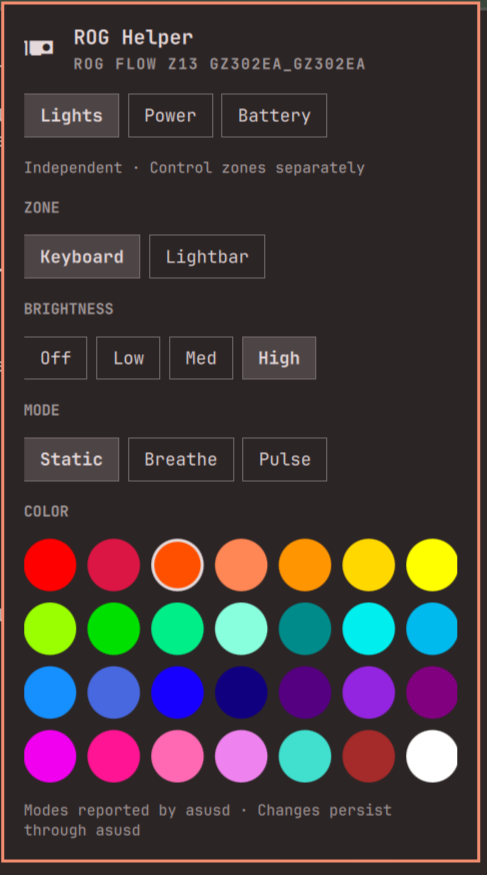

# ROG Helper for Omarchy

A compact control panel for ASUS laptops, built into the Omarchy shell. Manage
lighting, power profiles and battery charging from the bar or the physical ROG
button. The panel follows your current Omarchy theme.



[Lights](docs/screenshots/lights.png) · [Power](docs/screenshots/power.png) · [Battery](docs/screenshots/battery.png)

## Features

- **Lighting:** independent keyboard and rear-lightbar controls, brightness,
  supported effects, theme Accent/Text/Alert buttons, a custom color picker and
  hex entry. The original preset palette is available under **Swatches**.
- **Power:** Quiet, Balanced and Performance profiles where available, plus
  temperature, fan-speed and firmware power-limit readings. The GZ302EA can
  switch its built-in screen between 60 Hz on battery and 180 Hz on AC.
- **Battery:** 60%, 80% and 100% charge limits, a one-time charge to 100%,
  battery power and capacity compared with design capacity.
- **Keyboard:** optional software Fn Lock for the GZ302EA detachable keyboard.
- **ROG button:** optional support for opening and closing the panel on GZ302EA.

Open the panel from the bar, use Tab to navigate controls, and press Escape to
close it. In **Lights**, select Keyboard or Lightbar before choosing a color.
Choose **Accent**, **Text**, or **Alert** for the keyboard to follow that
color role as the theme changes. ROG Helper installs a user theme hook on the
first selection. It applies your chosen role after Omarchy's keyboard retint,
including themes with a dedicated keyboard color. A custom color, swatch or
**Theme keyboard color** preset switches the keyboard back to manual selection.
The lightbar applies presets when clicked.

Themes with a dedicated keyboard color, such as Tokyo Night, show it as the
**Theme keyboard color** preset. The custom picker applies
on release, and a typed `#RRGGBB` value applies with **Apply** or Enter.
Brightness remains a separate hardware control.

Fan curves remain firmware-managed. Custom fan curves, undervolting,
power-limit tuning and GPU switching are outside the current release.

## Compatibility

Verified on **Omarchy Stable 4.5 (4.5.0-3)** with Hyprland 0.56.2 and
Quickshell 0.3.2 on the **ASUS ROG Flow Z13 GZ302EA (2025)**. Hardware status
reads, the running button service, all backend tests and isolated panel/theme/
color-routing checks pass. This Stable review did not change physical lighting or
battery settings.

Earlier hardware validation used Omarchy 4.0.4, Hyprland 0.56.2, Quickshell
0.3.1, asusctl 6.4.0 and z13ctl 1.4.2. Other models are untested. The physical
button and z13ctl rear-bar integrations remain restricted to GZ302EA.

The plugin detects available lighting devices, modes, brightness levels and
power profiles. Missing dependencies and unsupported controls are reported in
the panel. Support depends on the laptop, firmware and installed backends.

The optional button installer always targets the installed plugin directory
under `$XDG_CONFIG_HOME/omarchy/plugins/rog-helper` (normally `~/.config/...`).
Running the installer from a development checkout does not make the service
depend on that checkout. Moving or deleting a development folder leaves the
installed button listener available.

## Requirements

| Component | Purpose |
| --- | --- |
| Omarchy 4 with Quickshell | Native shell plugin and popup |
| Python 3 | Plugin backend; standard library only |
| GNU coreutils `timeout` | Deadline for hardware requests |
| `wl-paste` from wl-clipboard | Optional Ctrl+V for a custom `#RRGGBB` value |
| systemd `busctl` | Communication with asusd |
| asusctl and a running asusd service | Keyboard lighting and battery charge limits; tested with 6.4.0 |
| power-profiles-daemon and `powerprofilesctl` | Power profiles |
| wlr-randr | Optional automatic refresh rate on the GZ302EA |
| z13ctl | Optional GZ302EA rear-lightbar control; tested with 1.4.2 |
| udev, ACL tools (`setfacl`) and sudo | Optional hardware-access setup and removal |

Install and configure these dependencies through your distribution or their
upstream installation instructions before enabling the corresponding controls.

## Installation

```sh
omarchy plugin add https://github.com/austinwilkerson/omarchy-rog-helper.git --enable
```

For a local checkout, run `./scripts/install-local.sh` instead.

Click the ROG Helper bar icon to open the panel, or run:

```sh
omarchy-shell shell toggle rog-helper
```

### Optional: physical ROG button

On GZ302EA, enable the side button with:

```sh
~/.config/omarchy/plugins/rog-helper/scripts/install-button.sh
```

Setup installs a model-specific udev access rule and the
`rog-helper-button.service` user service. The listener handles the ROG button,
runs as your user and records no input. Access is limited to the matching WMI
hotkey device. Setup requires sudo and leaves Hyprland configuration unchanged.

### Optional: rear lightbar

The GZ302EA rear lightbar requires [z13ctl](https://github.com/dahui/z13ctl).
Install its CLI using the upstream instructions, then run:

```sh
~/.config/omarchy/plugins/rog-helper/scripts/install-lightbar.sh
```

This grants access to the model's rear-bar HID device. ROG Helper uses targeted
z13ctl commands for lighting; it does not require the z13ctl daemon or its fan
and power-tuning features. Without the CLI, rear-bar controls remain disabled.

The panel shows the rear bar's **last successfully applied settings**. If another
tool or a suspend/resume cycle changes the lights, reapply the desired setting.
Rear-bar state is saved in `$XDG_STATE_HOME/rog-helper/lightbar.json`, defaulting
to `~/.local/state/rog-helper/lightbar.json`.

### Optional: Z13 software Fn Lock

On Omarchy 4.5 with the Hyprland Lua configuration, attach the GZ302EA keyboard
and run this from your graphical session:

```sh
~/.config/omarchy/plugins/rog-helper/scripts/install-fnlock.sh
```

The setup uses Python 3 and `xkbcli` (from `libxkbcommon` on Arch). It generates
a media keymap from your configured XKB layout, variant and options. Setup
accepts a single layout and asks you to review conflicting device rules,
shortcuts, custom keymap files or multiple layouts. If you change your layout,
remove and set up Fn Lock again to generate a matching media keymap.

Use **Fn+Esc** or the **Keyboard** tab to select **Function keys** or
**Media keys**. The setting is saved and reapplied on reload and login.
It applies to the detachable keyboard's two verified device names. This
software mode is independent of the firmware's Fn behavior and Esc LED.

| Key in Media keys mode | Action |
| --- | --- |
| F1–F3 | Mute, volume down, volume up |
| F4 | Mute microphone |
| F5 | Cycle available power profiles |
| F6 | Open Omarchy screenshot capture |
| F7–F8 | Display brightness down/up |
| F9 | Open Omarchy Display controls |
| F10 | Toggle touchpad |
| F11 | Cycle keyboard backlight brightness |
| F12 | Toggle airplane mode through the user's existing rfkill access |

F11 uses Omarchy's keyboard backlight action. Manage the rear lightbar in
**Lights**. F12 blocks all radios when any are enabled and unblocks them on the
next press. Function keys mode lets your regular F-key bindings work, including
a custom F9 dictation shortcut.

Setup is opt-in and runs as your user. It backs up the two Hyprland files it
checks under `$XDG_STATE_HOME/rog-helper/fnlock/` (usually `~/.local/state`).
It recognizes the documented early Z13 setup and imports the old flag's mode.
Removal restores those original rules and leaves the original flag available.

## Settings and persistence

In **Battery**, use **Charge to 100% once** while plugged in with a lower
charge cap. This uses asusd's one-shot charge operation. Unplugging the
charger restores your usual cap, including if you unplug before reaching 100%.
The button is available when asusd exposes this operation.

In **Power → Display refresh rate**, choose **Automatic** to use 60 Hz on
battery and 180 Hz on AC. The internal panel needs both rates at its current
resolution. Install `wlr-randr` for this optional feature. **Manual** stops
automatic switching and leaves the display at its current rate.

Battery power is the rate reported by the battery, and capacity is compared
with the battery's design capacity. Firmware power limits show the available
ASUS PL1, PL2 and PL3 readings for the active profile.

Keyboard lighting and charge limits are saved by asusd. Power profiles use
power-profiles-daemon, shared with Omarchy's power panel. asusd may apply its
configured AC or battery profile when the power source changes.

ROG Helper refreshes hardware readings every five seconds while the panel is
open. Rear-bar settings are last-applied values rather than firmware readback;
rear-bar persistence across reboot and suspend/resume is untested.

Use one utility at a time to change the same lighting or tuning settings. The
plugin uses existing backends and preserves their service configuration.

## Removal

If you enabled an optional component, run its removal script before removing
the plugin:

```sh
~/.config/omarchy/plugins/rog-helper/scripts/remove-fnlock.sh
~/.config/omarchy/plugins/rog-helper/scripts/remove-button.sh
~/.config/omarchy/plugins/rog-helper/scripts/remove-lightbar.sh
omarchy plugin remove rog-helper
```

If you used keyboard theme following, remove its user hook with
`rm ~/.config/omarchy/hooks/theme-set.d/90-rog-helper-theme.sh`. The saved role
is under `$XDG_STATE_HOME/rog-helper/keyboard-theme-role` (usually
`~/.local/state/rog-helper/keyboard-theme-role`).

The Fn Lock remover restores the prior Hyprland input rules and shortcut.
The button and lightbar scripts remove the optional user service, udev rules and active device-access
grants. External dependencies and saved settings are retained. Set your preferred
charge limit and lighting before removal. Any existing Hyprland hotkey workaround
is preserved.

## Development and support

```sh
python3 -m unittest discover -s tests -v
omarchy plugin validate .
```

For a theme-binding integration check in an active Omarchy Wayland session, run
`./tests/check-qml.sh`. It uses an isolated instance and leaves the desktop theme
unchanged.

See [validation results](VALIDATION.md), [backend research](RESEARCH.md) and
[third-party notices](THIRD_PARTY_NOTICES.md) for technical details.

[Report an issue](https://github.com/austinwilkerson/omarchy-rog-helper/issues)
with your laptop model, kernel, Omarchy and asusctl versions, the affected control
and its error message. Remove serial numbers and other personal information from
any logs you share.

## License

[MIT](LICENSE). An independent community project, unaffiliated with ASUS,
Omarchy or G-Helper.

## Z13 troubleshooting: phantom hotkey events

Some GZ302EA systems emit repeated `KEY_UNKNOWN` events from **Asus WMI hotkeys**,
which can interfere with shortcuts. If you experience this, the following
Omarchy/Hyprland Lua override disables that device in the compositor:

```lua
hl.device({ name = "asus-wmi-hotkeys", enabled = false })
```

Add it to `~/.config/hypr/input.lua`, then run `hyprctl reload` and
`hyprctl configerrors` to check the configuration. This disables the hotkeys
provided by that device; normal keyboard input uses separate devices. ROG
Helper's optional button listener can still handle the side button while this
override is active. If you already use the workaround, keep it enabled.
