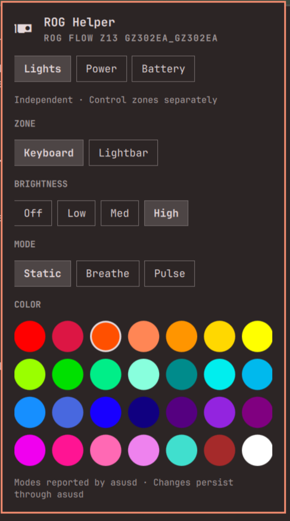

# ROG Helper for Omarchy

A compact control panel for ASUS laptops, built into the Omarchy shell. Manage
lighting, power profiles and battery charging from the bar or the physical ROG
button. The panel follows your current Omarchy theme.



[Lights](docs/screenshots/lights.png) · [Power](docs/screenshots/power.png) · [Battery](docs/screenshots/battery.png)

## Features

- **Lighting:** independent keyboard and rear-lightbar controls, brightness,
  supported effects, theme Accent/Text/Alert buttons, a custom color picker and
  hex entry. The original preset palette is available under **Swatches**.
- **Power:** Quiet, Balanced and Performance profiles where available, plus
  temperature and fan-speed readings.
- **Battery:** 60%, 80% and 100% charge limits.
- **ROG button:** optional support for opening and closing the panel on GZ302EA.

Open the panel from the bar, use Tab to navigate controls, and press Escape to
close it. In **Lights**, select Keyboard or Lightbar before choosing a color.
Theme buttons apply the current theme color to that zone; they do not change
hardware automatically when the desktop theme changes. The custom picker applies
on release, and a typed `#RRGGBB` value applies with **Apply** or Enter.
Brightness remains a separate hardware control.

Fan curves remain firmware-managed. Custom fan curves, undervolting,
power-limit tuning and GPU switching are outside the current release.

## Compatibility

Tested on **ASUS ROG Flow Z13 GZ302EA (2025)** with Omarchy 4.0.4,
Hyprland 0.56.2, Quickshell 0.3.1, asusctl 6.4.0 and z13ctl 1.4.2.
Theme bindings also pass an isolated load and live-color check on Edge with
Qt 6.12 and Quickshell 0.3.2. Other models are untested. The physical-button integration and z13ctl rear-bar
integration are restricted to GZ302EA.

The plugin detects available lighting devices, modes, brightness levels and
power profiles. Missing dependencies and unsupported controls are reported in
the panel. Support depends on the laptop, firmware and installed backends.

## Requirements

| Component | Purpose |
| --- | --- |
| Omarchy 4 with Quickshell | Native shell plugin and popup |
| Python 3 | Plugin backend; standard library only |
| systemd `busctl` | Communication with asusd |
| asusctl and a running asusd service | Keyboard lighting and battery charge limits; tested with 6.4.0 |
| power-profiles-daemon and `powerprofilesctl` | Power profiles |
| z13ctl | Optional GZ302EA rear-lightbar control; tested with 1.4.2 |
| udev, ACL tools (`setfacl`) and sudo | Optional hardware-access setup and removal |

Install and configure these dependencies through your distribution or their
upstream installation instructions before enabling the corresponding controls.

## Installation

```sh
omarchy plugin add https://github.com/austinwilkerson/omarchy-rog-helper.git --enable
```

For a local checkout, run `./scripts/install-local.sh` instead.

Click the ROG Helper bar icon to open the panel, or run:

```sh
omarchy-shell shell toggle rog-helper
```

### Optional: physical ROG button

On GZ302EA, enable the side button with:

```sh
~/.config/omarchy/plugins/rog-helper/scripts/install-button.sh
```

Setup installs a model-specific udev access rule and the
`rog-helper-button.service` user service. The listener handles the ROG button,
runs as your user and records no input. Access is limited to the matching WMI
hotkey device. Setup requires sudo and leaves Hyprland configuration unchanged.

### Optional: rear lightbar

The GZ302EA rear lightbar requires [z13ctl](https://github.com/dahui/z13ctl).
Install its CLI using the upstream instructions, then run:

```sh
~/.config/omarchy/plugins/rog-helper/scripts/install-lightbar.sh
```

This grants access to the model's rear-bar HID device. ROG Helper uses targeted
z13ctl commands for lighting; it does not require the z13ctl daemon or its fan
and power-tuning features. Without the CLI, rear-bar controls remain disabled.

The panel shows the rear bar's **last successfully applied settings**. If another
tool or a suspend/resume cycle changes the lights, reapply the desired setting.
Rear-bar state is saved in `$XDG_STATE_HOME/rog-helper/lightbar.json`, defaulting
to `~/.local/state/rog-helper/lightbar.json`.

## Settings and persistence

Keyboard lighting and charge limits are saved by asusd. Power profiles use
power-profiles-daemon, shared with Omarchy's power panel. asusd may apply its
configured AC or battery profile when the power source changes.

ROG Helper refreshes hardware readings every five seconds while the panel is
open. Rear-bar settings are last-applied values rather than firmware readback;
rear-bar persistence across reboot and suspend/resume is untested.

Use one utility at a time to change the same lighting or tuning settings. The
plugin uses existing backends and preserves their service configuration.

## Removal

If you enabled either optional component, run its removal script before removing
the plugin:

```sh
~/.config/omarchy/plugins/rog-helper/scripts/remove-button.sh
~/.config/omarchy/plugins/rog-helper/scripts/remove-lightbar.sh
omarchy plugin remove rog-helper
```

The scripts remove the optional user service, udev rules and active device-access
grants. External dependencies and saved settings are retained. Set your preferred
charge limit and lighting before removal. Any existing Hyprland hotkey workaround
is preserved.

## Development and support

```sh
python3 -m unittest discover -s tests -v
omarchy plugin validate .
```

For a theme-binding integration check in an active Omarchy Wayland session, run
`./tests/check-qml.sh`. It uses an isolated instance and leaves the desktop theme
unchanged.

See [validation results](VALIDATION.md), [backend research](RESEARCH.md) and
[third-party notices](THIRD_PARTY_NOTICES.md) for technical details.

[Report an issue](https://github.com/austinwilkerson/omarchy-rog-helper/issues)
with your laptop model, kernel, Omarchy and asusctl versions, the affected control
and its error message. Remove serial numbers and other personal information from
any logs you share.

## License

[MIT](LICENSE). An independent community project, unaffiliated with ASUS,
Omarchy or G-Helper.

## Z13 troubleshooting: phantom hotkey events

Some GZ302EA systems emit repeated `KEY_UNKNOWN` events from **Asus WMI hotkeys**,
which can interfere with shortcuts. If you experience this, the following
Omarchy/Hyprland Lua override disables that device in the compositor:

```lua
hl.device({ name = "asus-wmi-hotkeys", enabled = false })
```

Add it to `~/.config/hypr/input.lua`, then run `hyprctl reload` and
`hyprctl configerrors` to check the configuration. This disables the hotkeys
provided by that device; normal keyboard input uses separate devices. ROG
Helper's optional button listener can still handle the side button while this
override is active. If you already use the workaround, keep it enabled.
